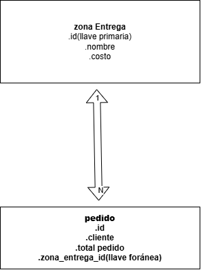

# PF-14 - Sistema de Pedidos de Entrega a Domicilio

**Estudiante:** Mynor Adolfo Girón Muralles
**Carné:** 9941-25-8300
**Curso:** Programación II

## 📝 Descripción del Problema
El sistema permite administrar pedidos de entrega a domicilio. Calcula automáticamente el costo de envío según la zona seleccionada, determina el total final a pagar, y permite dar seguimiento al estado de cada entrega (RECIBIDO, EN_RUTA, ENTREGADO, CANCELADO).

## 🛠️ Tecnologías Utilizadas
- **Backend:** Java, Spring Boot, Maven, Spring Data JPA, Jakarta Validation.
- **Base de Datos:** PostgreSQL.
- **Frontend:** HTML, CSS, JavaScript (Fetch API).

## 📂 Estructura y Relaciones
El backend está organizado por capas:
- `entity`: Clases `ZonaEntrega` y `Pedido` (con relación bidireccional `@OneToMany` / `@ManyToOne`).
- `repository`: Interfaces JPA para persistencia.
- `service`: Lógica de negocio y cálculos automáticos con `BigDecimal`.
- `controller`: Endpoints de la API REST.
- `dto`: Objetos de transferencia de datos con validaciones estrictas.
- `exception`: Manejo centralizado de errores.

## ⚙️ Funcionalidades y Reglas de Negocio
- **CRUD de Pedidos:** Registrar, listar, modificar y eliminar.
- **Gestión de Zonas:** CRUD para las zonas con validación de costos no negativos.
- **Transiciones de estado controladas:**
  - De `RECIBIDO` solo puede pasar a `EN_RUTA` o `CANCELADO`.
  - De `EN_RUTA` solo puede pasar a `ENTREGADO` o `CANCELADO`.
  - Un pedido `ENTREGADO` o `CANCELADO` no puede ser modificado.
- **Indicador:** Total facturado por fecha (excluye cancelados).
- **Seguridad:** Uso de `escapeHTML` en el Frontend y credenciales ocultas.

## 🔗 Endpoints Principales
- `GET /api/pedidos` (Listar todos)
- `POST /api/pedidos` (Registrar)
- `PUT /api/pedidos/{id}` (Modificar)
- `DELETE /api/pedidos/{id}` (Eliminar)
- `PATCH /api/pedidos/{id}/estado?estado=NUEVO_ESTADO` (Cambiar estado)
- `GET /api/zonas` (Listar zonas)
- `POST /api/zonas` (Crear zona con validación)
- `GET /api/pedidos/facturado/{fecha}` (Indicador)

## 🚀 Instrucciones para Ejecutar
1. Ejecutar el script `database.sql` en PostgreSQL para crear las tablas.
2. Configurar las credenciales en `src/main/resources/application.properties`.
3. Ejecutar `PedidosDomicilioApplication.java`.
4. Abrir el navegador en `http://localhost:8080/index.html`
